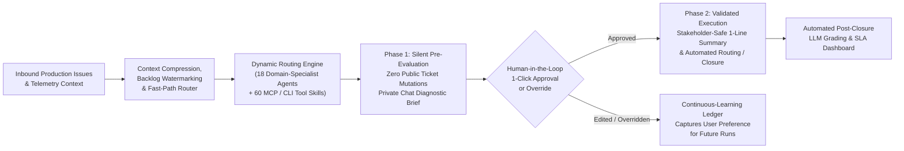

# Diego Ataide Rodrigues — AI Systems & Agent Architecture Portfolio

**Role:** Applied AI & Infrastructure Automation Engineer (10+ Years @ Google)  
**Contact:** [diegoarod@gmail.com](mailto:diegoarod@gmail.com)

> [!NOTE]
> *Because my production AI systems were built and deployed internally at Google, proprietary source code, internal URLs, and internal screenshots are omitted per confidentiality policy. Below are sanitized architectural case studies detailing the system designs, orchestration patterns, safety guardrails, and evaluation pipelines I architected and shipped personally.*

---

## Case Study 1: Autonomous Multi-Agent Triage & Diagnostic Orchestrator

### What I Built Myself (End-to-End Sole Architect)
I designed, coded in Python, tested, and shipped an internal marketplace **Multi-Agent AI Triage Platform** orchestrating **18 specialized domain agents** and **60+ tool skills**, complete with **Model Context Protocol (MCP)** integrations, a web Command Center UI, interactive Chat controls, a continuous-learning override ledger, and an automated LLM evaluation pipeline.

### Problem
Infrastructure and operations engineers manage high-volume, multi-system incident queues spanning optical transport, capacity planning, hardware logistics, and software workflows. Manual triage required cross-referencing half a dozen telemetry and ticketing tools per issue, while naive single-prompt LLM bots hallucinated root causes or posted noisy comments on live production tickets.

### System Architecture

### Key Architectural Decisions
1. **Two-Phase Silent Guardrails (Zero Spam by Default):**
   * **Phase 1** runs strictly read-only diagnostics and delivers a structured private brief in Chat with evidence, confidence verdicts, and proposed actions—never mutating live tickets unprompted.
   * **Phase 2** executes external status updates and posts a concise, non-technical **1-sentence stakeholder resolution summary** only after explicit operator confirmation.
2. **Deterministic Fast-Paths & Token Discipline:**
   * Pre-filters deterministic states in Python before invoking LLM reasoning, deduplicates repeated thread history, and watermarks legacy backlogs so autonomous polling never triggers runaway token spend.
3. **Continuous Preference Learning (`Override Once → Applied Next Time`):**
   * Persists structured operator overrides locally so recurring routing preferences and tone adjustments automatically condition subsequent evaluations.
4. **Automated Evaluation & SLA Observability:**
   * Built an embedded web dashboard and automated grading loop that scores agent pre-evaluations against final human-resolved ticket outcomes to track precision, SLA velocity, and regressions across releases.

---

## Case Study 2: Hybrid Generative + Programmatic Brand & Release Workflow

### What I Built Myself
I designed and automated a repeatable **multimodal brand-asset & release-announcement workflow** combining **Gemini / Imagen visual synthesis** with **deterministic HTML/CSS/SVG and Python compositing** across **9 consecutive product releases**.

### Problem
Pure text-to-image prompts suffer from two classic failure modes across iterative product launches: **character/style drift** between versions and **corrupted micro-typography** on technical UI badges and release metrics—plus poor legibility when downsampled to `18x18 px` profile icons.

### Workflow Design
1. **Style-Locked Prompt Templates & Reference Conditioning:** Separated invariant brand tokens (color hex palette, character silhouette, lighting, negative clutter constraints) from surface-specific framing rules (`16:9` hero scene vs. high-contrast symmetrical crest geometry engineered for `18px` downsampling).
2. **Decoupled Deterministic Typography:** Paired generative character/scene layers with programmatic vector/UI callout overlays and automated release-drift tests—achieving consistent visual identity and **100% typographic accuracy** across every release cycle.
